<a href="https://askrueger.github.io/webportfolio/">
  <picture>
    <source media="(prefers-color-scheme: dark)" srcset="assets/header-dark.svg">
    
  </picture>
</a>

<p align="center">
  <a href="https://askrueger.github.io/webportfolio/"><b>Portfolio</b></a> &nbsp;·&nbsp;
  <a href="https://askrueger.github.io/webportfolio/cv/alonso-amador-sanchez-cv.pdf"><b>CV en PDF</b></a> &nbsp;·&nbsp;
  <a href="https://www.linkedin.com/in/alonso-amador/"><b>LinkedIn</b></a> &nbsp;·&nbsp;
  <a href="mailto:alonsoamadorsanchez@gmail.com"><b>Email</b></a>
</p>

<br>

Construyo **apps Android con Kotlin y Jetpack Compose** y **backends con Java y Spring Boot**, desde la API hasta la app en Google Play, con tests y documentación que dicen la verdad. Antes estudié Turismo y trabajé de cara al público: sé escuchar qué necesita la persona al otro lado.

<picture>
  <source media="(prefers-color-scheme: dark)" srcset="assets/stats-dark.svg">
  
</picture>

<br><br>

## Proyectos

Cinco apps en prueba cerrada en Google Play. Pulsa una tarjeta para ver capturas, decisiones técnicas y código en el portfolio.

<a href="https://askrueger.github.io/webportfolio/proyectos/explorersaga/">
  <picture>
    <source media="(prefers-color-scheme: dark)" srcset="assets/project-explorersaga-dark.svg">
    
  </picture>
</a>

<a href="https://askrueger.github.io/webportfolio/proyectos/3d-cost-manager/"><picture><source media="(prefers-color-scheme: dark)" srcset="assets/project-3d-cost-manager-dark.svg"></picture></a> <a href="https://askrueger.github.io/webportfolio/proyectos/training-arc/"><picture><source media="(prefers-color-scheme: dark)" srcset="assets/project-training-arc-dark.svg"></picture></a>

<a href="https://askrueger.github.io/webportfolio/proyectos/animewatchlist/"><picture><source media="(prefers-color-scheme: dark)" srcset="assets/project-animewatchlist-dark.svg"></picture></a> <a href="https://askrueger.github.io/webportfolio/proyectos/bingogoals/"><picture><source media="(prefers-color-scheme: dark)" srcset="assets/project-bingogoals-dark.svg"></picture></a>

<sub>Código: [ExplorerSaga](https://github.com/AsKrueger/ExplorerSaga-Extremadura) · [3D Cost Manager](https://github.com/AsKrueger/Calculadora3D/tree/develop) · [Training Arc](https://github.com/AsKrueger/Training-Arc/tree/develop) · [AnimeWatchlist](https://github.com/AsKrueger/AnimeWatchlist) · [BingoGoals](https://github.com/AsKrueger/BingoGoals) ([demo web](https://askrueger.github.io/BingoGoals/)) &nbsp;|&nbsp; Más: [RadarTren](https://github.com/AsKrueger/RadarTren) · [Ahorrino](https://github.com/AsKrueger/Ahorrino)</sub>

<br>

## Un poco de código

Sumar un margen al coste no basta: Etsy o Amazon cobran su comisión **sobre el total con IVA**, y el beneficio real sale menor del que crees. En [3D Cost Manager](https://askrueger.github.io/webportfolio/proyectos/3d-cost-manager/) el precio se despeja de la ecuación para que, tras el IVA y la comisión, quede exactamente el beneficio buscado, y la app avisa si no existe ningún precio que lo consiga.

```kotlin
/**
 * Precio con IVA (lo que paga el cliente) tal que, tras quitar el IVA y la comisión del canal,
 * queda el coste más el beneficio buscado:
 *   bruto / (1 + iva) - bruto * comisión - fijo = coste + beneficio
 */
private fun price(cost: BigDecimal, pricing: Pricing, channel: ChannelFees,
                  vatPercent: BigDecimal, rounding: PriceRounding): Priced {
    val vat = vatPercent.nonNeg().div(HUNDRED)
    val fee = channel.feePercent.nonNeg().div(HUNDRED)
    val fixed = channel.fixedFee.nonNeg()
    val netFactor = BigDecimal.ONE.div(BigDecimal.ONE + vat) - fee

    val gross: BigDecimal
    var feasible = true
    when (pricing.mode) {
        PricingMode.FIXED_PRICE -> gross = pricing.value.nonNeg()
        PricingMode.MARKUP, PricingMode.TARGET_PROFIT -> {
            val target = if (pricing.mode == PricingMode.MARKUP)
                cost * pricing.value.nonNeg().div(HUNDRED) else pricing.value.nonNeg()
            if (netFactor.signum() <= 0) {
                // Comisión e IVA se comen todo el precio: no hay precio que dé beneficio
                feasible = false
                gross = zero()
            } else {
                gross = rounding.roundUp((cost + target + fixed).div(netFactor))
            }
        }
    }

    val vatAmount = gross - gross.div(BigDecimal.ONE + vat)
    val fees = if (gross.signum() == 0) zero() else gross * fee + fixed
    val profit = gross - vatAmount - fees - cost
    return Priced(gross, vatAmount, fees, profit, feasible)
}
```

<sub>[CostEngine.kt](https://github.com/AsKrueger/Calculadora3D/blob/develop/android/app/src/main/java/com/tdcostmanager/app/core/calc/CostEngine.kt#L100-L139) · Kotlin puro, sin Android, con `BigDecimal` a 8 decimales internos y redondeo `HALF_UP` a 4: con dinero, `double` acaba en céntimos que no cuadran.</sub>

<details>
<summary><b>Otro ejemplo: actualizar contenido sin romper nada</b> (ExplorerSaga)</summary>
<br>

La app solo instala un paquete de contenido nuevo si su esquema es compatible, si es más nuevo que el instalado y si el tamaño y el sha256 coinciden con el manifiesto. Un mutex evita que dos importaciones se pisen, y cualquier fallo de red deja el contenido anterior intacto.

```kotlin
suspend fun sync(): SyncResult = withContext(Dispatchers.IO) {
    try {
        val manifest = ContentImporter.json.decodeFromString<ContentManifest>(
            download(baseUrl + MANIFEST).decodeToString()
        )
        if (manifest.schema != ContentImporter.SUPPORTED_SCHEMA) return@withContext SyncResult.UP_TO_DATE
        if (manifest.version <= (dao.meta()?.version ?: 0)) return@withContext SyncResult.UP_TO_DATE

        val bytes = download(baseUrl + manifest.file)
        if (bytes.size.toLong() != manifest.size || ContentImporter.sha256(bytes) != manifest.sha256) {
            Log.w(TAG, "Paquete descartado: tamaño o hash no coinciden")
            return@withContext SyncResult.FAILED
        }
        importMutex.withLock {
            import(ContentImporter.readPack(ByteArrayInputStream(bytes)))
        }
        SyncResult.UPDATED
    } catch (e: IOException) {
        Log.w(TAG, "No se pudo actualizar el contenido", e)
        SyncResult.FAILED
    } catch (e: IllegalArgumentException) {
        Log.w(TAG, "Paquete de contenido no válido", e)
        SyncResult.FAILED
    }
}
```

<sub>[ContentRepository.kt](https://github.com/AsKrueger/ExplorerSaga-Extremadura/blob/main/app/src/main/java/com/alonso/explorersaga/data/content/ContentRepository.kt)</sub>

</details>

<br>

## Cómo trabajo

<picture>
  <source media="(prefers-color-scheme: dark)" srcset="assets/principles-dark.svg">
  
</picture>

<br>

## Actividad

<a href="https://github.com/AsKrueger?tab=repositories&sort=pushed">
  <picture>
    <source media="(prefers-color-scheme: dark)" srcset="assets/activity-dark.svg">
    
  </picture>
</a>

<sub>Se actualiza cada día con una GitHub Action propia ([tools/build_assets.py](tools/build_assets.py)), sin servicios externos.</sub>

<br>

## Stack

<picture>
  <source media="(prefers-color-scheme: dark)" srcset="assets/stack-dark.svg">
  
</picture>

<br><br>

## Trayectoria

<picture>
  <source media="(prefers-color-scheme: dark)" srcset="assets/timeline-dark.svg">
  
</picture>

<sub>Español nativo · Inglés B1, con lectura técnica fluida · También C#, .NET, Unity y Python</sub>

<br><br>

<p align="center">
  <b>¿Buscas un desarrollador junior que cuide los detalles?</b><br>
  <a href="mailto:alonsoamadorsanchez@gmail.com">alonsoamadorsanchez@gmail.com</a> &nbsp;·&nbsp;
  <a href="https://www.linkedin.com/in/alonso-amador/">LinkedIn</a> &nbsp;·&nbsp;
  <a href="https://askrueger.github.io/webportfolio/">Portfolio</a>
</p>
